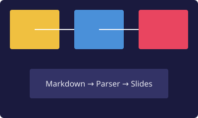
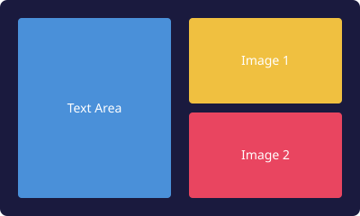

---
theme:
  background: "#0f0f23"
  color: "#e8e8f0"
  font-heading: "Georgia, serif"
  font-body: "system-ui, -apple-system, sans-serif"
  accent: "#f0c040"
---

# Web Slideshow

A git-friendly, markdown-powered presentation engine.

## What Is It?

- Write presentations in **plain Markdown**
- Open in any browser — **no server needed**
- Everything tracked in **git**

```
# Title        → Presentation title
## Heading     → New slide
### Subheading → Section within slide
```

## Why Markdown?

1. **Version controllable** — `git log` shows every change
2. **Diff-friendly** — plain text diffs are readable
3. **Editor agnostic** — works in any text editor
4. **Portable** — `.md` files open everywhere
5. **No binary formats** — no .pptx corruption

## Features

- Keyboard navigation (arrows, space, home, end)
- Touch/swipe support on mobile
- Dynamic image layout based on text density
- YAML front-matter theming
- Per-slide theme overrides
- File picker to load local presentations
- Smooth fade transitions
- Progress bar and slide counter

## Theming

Add a YAML front-matter block to customize colors and fonts:

```yaml
---
theme:
  background: "#1a1a2e"
  color: "#eaeaea"
  accent: "#e94560"
  layout: "wide"
---
```

Defaults work fine if you skip it.

## Image Layout

Images are placed dynamically based on text density:

- **Sparse text** → image on the left
- **Dense text** → image on the right
- **Multiple images** → left/right alternating

Small images stay inline. No manual positioning needed.






## Navigation

| Key | Action |
|-----|--------|
| `→` / `Space` | Next slide |
| `←` | Previous slide |
| `Home` / `g` | First slide |
| `End` / `G` | Last slide |
| `f` | Load .md file |
| `?` | Help overlay |

You can also **click** the left/right edges of a slide to navigate.

## Markdown Showcase

Full CommonMark support via `marked.js` — here's everything:

### Text Formatting

**Bold text** for emphasis. *Italic text* for subtle points. ***Bold italic***
for maximum weight. ~~Strikethrough~~ for corrections.

Inline `code` uses backticks. A longer `const x = 42; // inline code example`
stays readable.

### Lists

Nested lists work naturally:

1. First item
2. Second item
   - Sub-point A
   - Sub-point B
     - Deeper level
3. Third item

### Blockquotes

> A presentation should inspire, not overwhelm.
> — *Principle of clean slides*

### Code Blocks

```python
def fibonacci(n):
    a, b = 0, 1
    for _ in range(n):
        yield a
        a, b = b, a + b

print(list(fibonacci(10)))
```

### Tables

| Feature          | Status  | Priority |
|------------------|---------|----------|
| Keyboard nav     | ✅ Done | High     |
| Image layout     | ✅ Done | High     |
| Speaker notes    | 🔲 TBD  | Medium   |
| PDF export       | 🔲 TBD  | Low      |

### Links and Images

[Visit marked.js on GitHub](https://github.com/markedjs/marked)


---

That's the full range — plain text, your whole toolbox.

## Get Started

1. Clone the repo
2. Write your `.md` presentation in `slides/`
3. Open `index.html` in a browser
4. Press `f` to load your file
5. Navigate with arrow keys

That's it. No build step, no dependencies to install.

## Built With

- **HTML + CSS + vanilla JS** — no framework
- **marked.js** — Markdown parsing (CDN)
- **CSS Grid** — dynamic layouts
- **CSS custom properties** — theming
